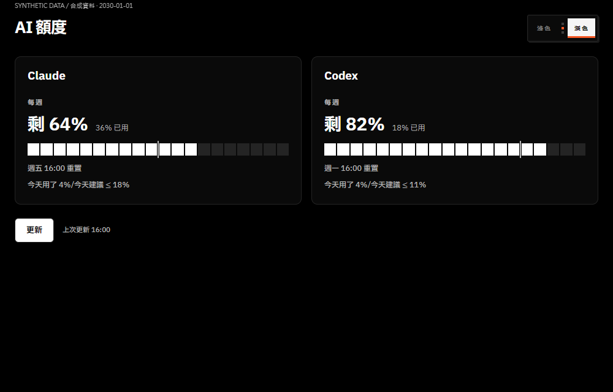
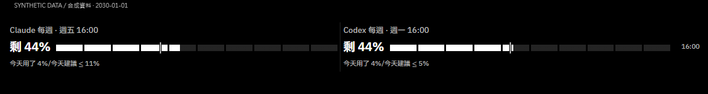
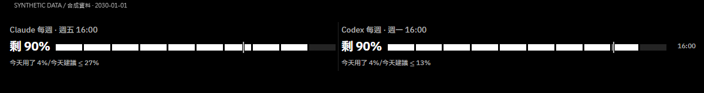
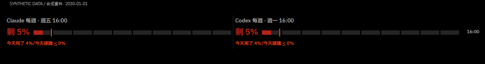
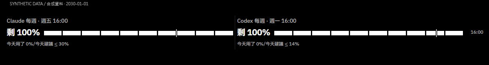
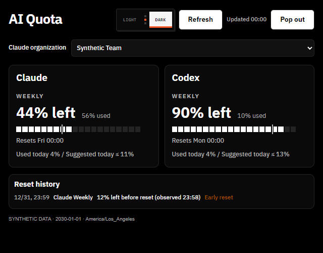
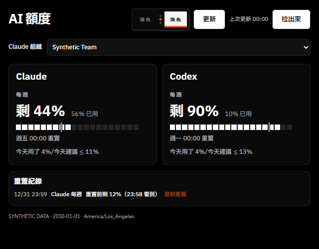

# AI 額度小工具 / AI Quota Badge

[繁體中文](#繁體中文) · [English](#english)

## 繁體中文

非官方 Chrome Manifest V3 擴充功能，用來查看 Claude 與 Codex 每週剩餘額度、重置時間及每日建議用量。與 Anthropic、OpenAI 或 Google 無隸屬、合作或背書關係。

**本工具依賴 Claude／ChatGPT 網站內部端點，不是官方公開開發者 API；端點、回應格式與驗證方式隨時可能變更或失效。** 不保證所有方案、組織或帳號皆可使用。Claude 有多個組織時可在標題下方選擇；未選擇時使用第一個，只有一個組織時隱藏選單。Codex 使用 ChatGPT session 的 account ID。公開原始碼不代表官方支援。

### 安裝與更新

1. 下載／解壓此專案，或將原始碼複製到本機資料夾。
2. 在 Chrome 開啟 `chrome://extensions`，開啟「開發人員模式」。
3. 按「載入未封裝項目」，選擇包含 `manifest.json` 的專案資料夾。
4. 在同一個 Chrome 個人資料中，手動登入 `claude.ai` 與 `chatgpt.com`。
5. 點擴充功能圖示查看額度；「拉出來」可開啟獨立視窗。
6. 更新程式後，在擴充功能管理頁按重新載入，再重開視窗。

需要 Chrome 116 或更新版本；使用擴充功能不需要 Node.js、API 金鑰、npm install 或編譯。

### 顯示與限制

- 每 5 分鐘嘗試背景更新；手動／自動更新至少間隔 60 秒。休眠或 Chrome 關閉時不會準時更新。
- 「今天用了」以昨天最後一筆成功讀數為起點；沒有昨日資料則用今天第一筆。跨重置時改用重置後第一筆。日期以使用者電腦的本地日期為準；未被觀測到的使用量不保證完整。
- 「今天建議 ≤」是自訂估算，不是官方每日額度：以剩餘週額度扣除保留量（Claude 10、Codex 15 個百分點）後，除以距離重置的天數，四捨五入並限制於 0–100。
- 獨立視窗高度不超過 200px 時顯示 10 格橫條，每格 10%；最後一格按比例填色。建議標記按百分比定位。
- 超過 10 分鐘未更新的資料以灰字和「· 舊」標示。所有顯示時間（週重置、重置紀錄、上次更新）都使用電腦本地時區，隨系統設定。
- 介面依 Chrome UI 語言自動選擇：`zh` 開頭使用繁體中文，其他使用英文；沒有語言切換鈕。
- 切換 Claude 組織會重新讀取額度，並清除前一組織的 Claude 快照、重置紀錄與每日計算起點，避免混算；Codex 不受影響。
- 支援深淺色、重置紀錄及記住獨立視窗位置。工具列 badge 可能採用其他可取得的週期，以所有成功來源中的最低剩餘額度顯示。
- 401／403 會暫停該來源；第一次授權失敗後，使用者手動登入可再按更新重試一次。其他相同錯誤連續兩次後也暫停；另一來源不受影響。不繞過登入或驗證。

### 資料與隱私

本工具持久保存的使用資料只存在本機 `chrome.storage.local`：整理後的額度、重置／更新時間、錯誤與重試狀態、48 小時內快照、最多 30 筆重置事件、每日計算起點、主題、所選 Claude 組織 ID 與視窗位置／螢幕識別。組織名稱只供畫面顯示，保留在記憶體，不寫入額度快照、重置紀錄或本機儲存。清理在更新時執行，休眠期間不會執行。沒有雲端同步、分析追蹤、第三方資料收集或自動檔案匯出。

網路僅向下列原站查詢。瀏覽器依 cookie 規則送出登入 cookie；ChatGPT access token 和 account ID 僅用於同站額度請求，Claude organization ID 用於同站路徑。登入 cookie、token 與 ChatGPT account ID 不寫入本機儲存；Claude 組織 ID 另存為本機選擇設定；token 只在請求期間的記憶體中使用。整理後的額度數字不會額外上傳。一般 HTTPS 連線仍會讓原站收到 IP、瀏覽器請求資訊及查詢時間。

| 方法／端點 | 用途 |
| --- | --- |
| GET `https://claude.ai/api/organizations` | 取得 organization |
| GET `https://claude.ai/api/organizations/{uuid}/usage` | Claude 額度 |
| GET `https://chatgpt.com/api/auth/session` | 取得登入驗證資料 |
| GET `https://chatgpt.com/backend-api/wham/usage` | Codex 額度 |

### 權限

| 權限 | 用途 |
| --- | --- |
| `storage` | 本機設定、額度與紀錄 |
| `alarms` | 背景定期更新 |
| `system.display` | 讀取螢幕工作區，還原獨立視窗位置；不修改螢幕設定 |
| `https://claude.ai/*` | 向 Claude 原站讀取組織與額度 |
| `https://chatgpt.com/*` | 向 ChatGPT 原站讀取 session 與 Codex 額度 |

不要求 `downloads`、`cookies`、`tabs` 或 `nativeMessaging` 權限。沒有 `cookies` 權限不代表請求不會攜帶登入 cookie。

### 測試、合成範例與授權

使用 Node.js 24 執行 `npm test`。測試以假回應驗證，不登入、不呼叫實際額度 API。

`examples/quota-state.json` 和下方截圖完全使用合成資料，時間固定為 2030-01-01，與任何真實帳號無關。截圖是本機頁面預覽，不是已登入擴充的實機截圖。重做截圖可在開發環境提供 Playwright 與 Chrome，執行 `node scripts/render-previews.cjs` 與 `node scripts/check-localized-previews.cjs`；此工具會攔截全部請求，只提供專案內的檔案，不連線原站。

程式與專案圖示採 [MIT](LICENSE)；內附 IBM Plex 字體另採 [SIL OFL 1.1](fonts/OFL.txt)，版權及來源見 [第三方聲明](THIRD_PARTY_NOTICES.md)。第三方名稱／商標不代表背書。

## English

An unofficial Chrome Manifest V3 extension showing Claude and Codex weekly remaining quota, reset times, and estimated daily budgets. It is not affiliated with or endorsed by Anthropic, OpenAI, or Google.

**This tool depends on internal Claude/ChatGPT website endpoints, not supported public developer APIs. Endpoints, response formats, and authentication may change or stop working at any time.** Compatibility with every plan, organization, or account is not guaranteed. When Claude returns multiple organizations, choose one below the title. The first is the default; the selector is hidden for a single organization; Codex uses the account ID from the ChatGPT session.

### Installation

1. Download and extract the project into a local folder.
2. Open `chrome://extensions` in Chrome and enable **Developer mode**.
3. Select **Load unpacked** and choose the folder containing `manifest.json`.
4. Sign in to `claude.ai` and `chatgpt.com` manually in the same Chrome profile.
5. Click the extension icon. The pop-out button opens a standalone window.
6. After updating files, reload the extension and reopen its window.

Chrome 116+ is required. Running the extension requires no Node.js, API key, dependency installation, or build step. The interface follows the Chrome UI language: languages starting with `zh` use Traditional Chinese, and all others use English. There is no language switch.

### Behavior and limitations

Background refresh runs approximately every five minutes, with a minimum one-minute interval between attempts. Sleep and browser shutdown delay refreshes. Today's observed usage starts at yesterday's last successful reading, falling back to today's first reading. A detected reset starts a new baseline at the first post-reset reading. Local calendar dates are used; gaps in observation can leave usage unmeasured.

The suggested daily budget is an estimate, not an official limit: subtract a reserve of 10 percentage points for Claude or 15 for Codex from remaining weekly quota, divide by days until reset, round, and clamp to 0–100. Compact windows use ten cells with proportional partial fill. Data older than ten minutes is gray and marked `· old` in English. All displayed times (weekly resets, reset history, and last update) use the computer’s local timezone through Intl defaults. Themes, reset history, and remembered window placement are supported. The toolbar badge may include additional available quota windows.

Changing the Claude organization immediately reloads its quota and clears the previous organization’s Claude snapshots, reset events, and daily baseline to prevent mixed calculations. Codex data is preserved.

Authorization failures pause that provider. After an initial 401/403, manually signing in permits one manual retry. Other repeated identical errors also pause updates after two failures. The other provider continues normally. No login or verification bypass is implemented.

### Privacy and network access

All usage data persisted by this extension stays in local `chrome.storage.local`: normalized quotas, timestamps, error/retry state, up to 48 hours of snapshots, up to 30 reset events, daily baselines, theme, selected Claude organization IDs, and window/display placement. Organization names remain in memory for display only; they are never saved to local storage, quota snapshots, or reset history. Retention cleanup runs during updates, not while the browser is asleep. There is no cloud sync, analytics, third-party collection, or automatic file export.

Only the original provider websites receive quota queries and the authentication needed for them. Browser cookies follow normal cookie rules. The ChatGPT access token and account ID are sent only to its own usage endpoint; the Claude organization ID is used in its own usage URL and saved locally as a selection preference. Cookies, tokens, and the ChatGPT account ID are not persisted by the extension; the token is held temporarily in request memory. Retrieved quota numbers are not uploaded elsewhere. Normal HTTPS requests still reveal connection/request metadata such as IP address and query timing to the provider.

The four GET endpoints are listed in the table above. All four are internal website endpoints.

| Permission | Purpose |
| --- | --- |
| `storage` | Local preferences, quota state, and history |
| `alarms` | Scheduled background refresh |
| `system.display` | Read display work areas to restore window placement; no display settings changes |
| `https://claude.ai/*` | Read Claude organization and usage |
| `https://chatgpt.com/*` | Read ChatGPT session and Codex usage |

No `downloads`, `cookies`, `tabs`, or `nativeMessaging` permission is requested. Omitting the `cookies` permission does not prevent authenticated requests from carrying cookies.

### Development and licensing

Run `npm test` with Node.js 24. Tests use synthetic responses and do not access live accounts. `examples/quota-state.json` and all screenshots use synthetic data with a fixed date of 2030-01-01. To regenerate previews, make Playwright and Chrome available in your development environment and run `node scripts/render-previews.cjs` and `node scripts/check-localized-previews.cjs`. All preview requests are intercepted and served from local project files.

Code and project icons: [MIT](LICENSE). Bundled IBM Plex fonts: [SIL Open Font License 1.1](fonts/OFL.txt); see [third-party notices](THIRD_PARTY_NOTICES.md). Third-party trademarks do not imply endorsement.

## Synthetic previews / 合成資料預覽

